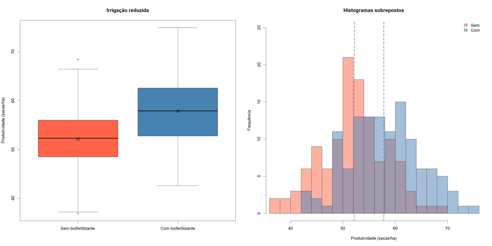
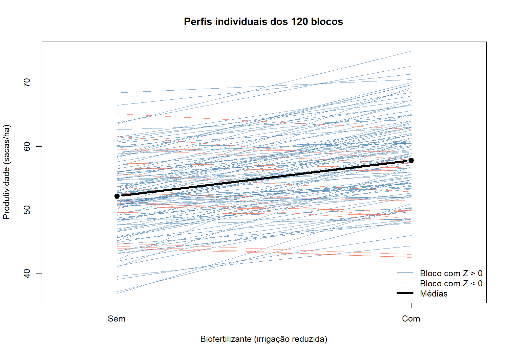
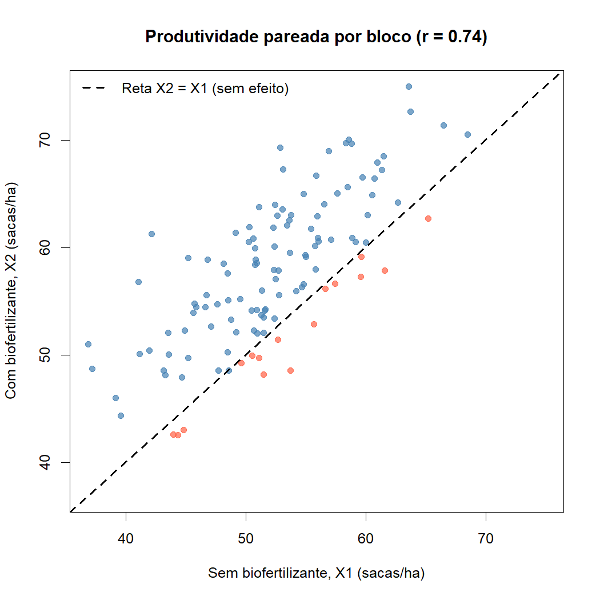
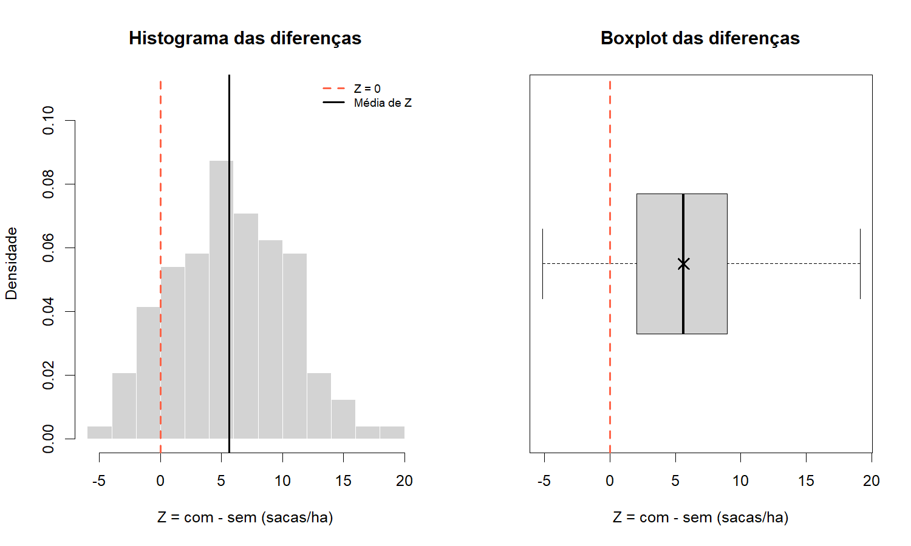
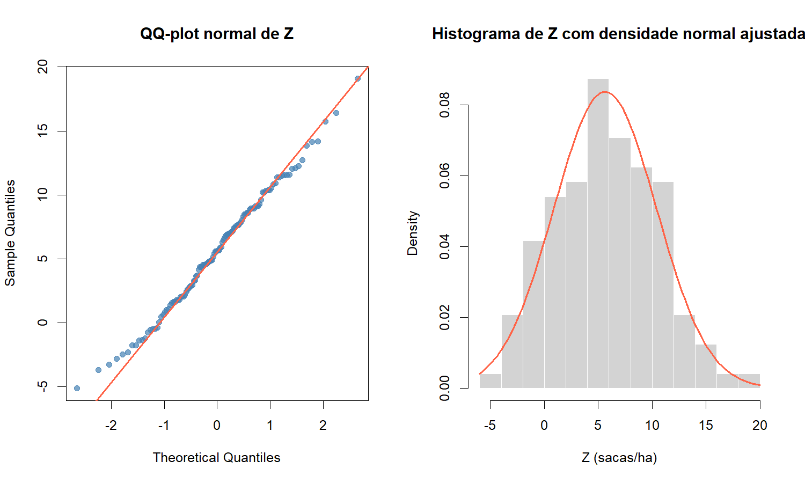
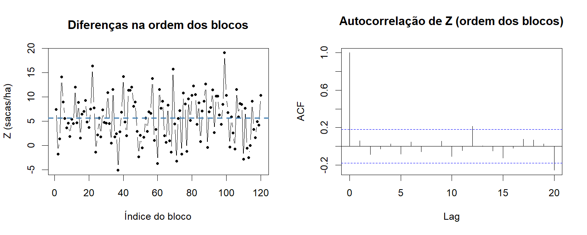

Objetivo: fixando nível de irrigação baixa. queremos ver se biofertilizante faz efeito na produtividade de milho. Além disso comparar métodos: jeito frequentista e teste de permutação, e bootstrap.

---

# 1. Descrição da base de dados e de cada variável.

## Descição inicial da base de dados

Reutilizamos a base de dados "produtividade_milho.csv" disponibilizada pelo professor, que está em formato longo e contém 480 linhas: 120 blocos agrícolas (unidades experimentais), cada um observado sob os 4 tratamentos de um fatorial 2x2 (irrigação x biofertilizante, dois níveis pra cada). 

Não temos informações sobre o local de coleta...

As variáveis são:

### Variável quantitativa (resposta):

- "produtividade_sacas_ha": produtividade de milho, em sacas por hectare (contínua, numérica). Na base completa varia de 36,88 a 88,86 sacas/ha.


---

### Variáveis categóricas:

- "bloco": identificador da unidade experimental (Bloco_001, ..., Bloco_120). Não é uma variável de interesse em si, mas é essencial: é ela que diz quais observações vieram do **mesmo** bloco, ou seja, quais observações estão pareadas;
- "irrigacao": fator com 2 níveis (*reduzida* / *adequada*);
- "biofertilizante": fator com 2 níveis (*sem_biofertilizante* / *com_biofertilizante*);
- "tratamento": rótulo da combinação irrigação x biofertilizante (4 níveis). É redundante com as duas anteriores, só junta as duas em uma variável.


---


### Variáveis usadas neste trabalho: 

Supondo que estamos numa situação em que as grande empresas de tecnologia estão gastando muita água para treinar certos modelos de linguagem, deixando os recursos hídricos caros, e nossos amigos agricultores querem ver como que a produtividade do milho reage a biofertilizante com irrigação reduzida.

Logo o nosso *objetivo* é estudar o *efeito do biofertilizante* **fixando a irrigação reduzida**, vamos trabalhar apenas com as 240 linhas em que irrigacao == "reduzida". Nesse recorte a irrigação vira uma constante, e sobram:

- a resposta "produtividade_sacas_ha";
- o fator de interesse "biofertilizante" (sem / com);
- o identificador "bloco", que liga as duas medidas de um mesmo bloco.

Chamando de $X_{1j}$ a produtividade do bloco $j$ sob irrigação reduzida **sem** biofertilizante e de $X_{2j}$ a produtividade do mesmo bloco sob irrigação reduzida **com** biofertilizante, cada bloco fornece o par $(X_{1j}, X_{2j})$, $j = 1, \dots, 120$, e a diferença

$$Z_j = X_{2j} - X_{1j},$$

que mede o ganho (ou perda) de produtividade que o biofertilizante trouxe naquele bloco. Daí toda a análise inferencial será feita sobre os $Z_j$.

---

# 2. Tabelas de dados:

No trabalho que fizemos em Estatística Multivariada 1, conferimos que cada bloco aparece exatamente uma vez em cada tratamento (base completa) e que, no recorte com irrigação reduzida, cada bloco tem exatamente uma observação sem e uma com biofertilizante. 

(Se isso não valesse, o pareamento não estaria bem definido.)

| | sem_biofertilizante | com_biofertilizante |
|---|---|---|
| reduzida | 120 | 120 |
| adequada | 120 | 120 |

| sem_biofertilizante | com_biofertilizante |
|---|---|
| 120 | 120 |

---

| | bloco | irrigacao | biofertilizante | tratamento | produtividade_sacas_ha |
|---|---|---|---|---|---|
| 1 | Bloco_001 | reduzida | sem_biofertilizante | reduzida_sem_biofertilizante | 57.59 |
| 2 | Bloco_001 | reduzida | com_biofertilizante | reduzida_com_biofertilizante | 65.02 |
| 3 | Bloco_001 | adequada | sem_biofertilizante | adequada_sem_biofertilizante | 66.26 |
| 4 | Bloco_001 | adequada | com_biofertilizante | adequada_com_biofertilizante | 70.77 |
| 5 | Bloco_002 | reduzida | sem_biofertilizante | reduzida_sem_biofertilizante | 44.32 |
| 6 | Bloco_002 | reduzida | com_biofertilizante | reduzida_com_biofertilizante | 42.57 |

| bloco | irrigacao | biofertilizante | tratamento | produtividade_sacas_ha |
|---|---|---|---|---|
| Length: 480 | reduzida: 240 | sem_biofertilizante: 240 | reduzida_sem_biofertilizante: 120 | Min.: 36.88 |
| Class: character | adequada: 240 | com_biofertilizante: 240 | reduzida_com_biofertilizante: 120 | 1st Qu.: 53.73 |
| Mode: character | | | adequada_sem_biofertilizante: 120 | Median: 60.52 |
| | | | adequada_com_biofertilizante: 120 | Mean: 60.98 |
| | | | | 3rd Qu.: 67.84 |
| | | | | Max.: 88.86 |

| | bloco | sem | com | Z |
|---|---|---|---|---|
| 1 | Bloco_001 | 57.59 | 65.02 | 7.43 |
| 2 | Bloco_002 | 44.32 | 42.57 | -1.75 |
| 3 | Bloco_003 | 59.11 | 60.49 | 1.38 |
| 4 | Bloco_004 | 36.88 | 51.03 | 14.15 |
| 5 | Bloco_005 | 63.70 | 72.65 | 8.95 |
| 6 | Bloco_006 | 52.31 | 57.89 | 5.58 |

n = 120

---

# 3. Descrição do problema

No trabalho de Mult 1 vimos que, pelo gráfico de interação, tanto a irrigação quanto o biofertilizante parecem aumentar a produtividade, e que o efeito de um fator parece depender do nível do outro (linhas não paralelas). Por causa dessa possível interação, e da situação suposta dita na primeira seção, não faz muito sentido falar de "um único efeito do biofertilizante": ele pode ser diferente em cada nível de irrigação. Por isso, aqui **fixamos a irrigação reduzida**, que é a situação mais desfavorável para os produtores de milho, e perguntamos:

> **Sob irrigação reduzida, o uso de biofertilizante altera a produtividade média de milho?**

---

### Estrutura dos dados.

Reforçando mais uma vez: cada bloco recebeu os dois níveis de biofertilizante (em subparcelas diferentes). Então as duas amostras **não são independentes**: são medidas repetidas na mesma unidade experimental. O problema se reduz a um problema de **uma amostra** sobre as diferenças $Z_1, \dots, Z_{120}$, cuja média populacional chamamos de

$$\mu_Z = E(Z_j) = E(X_{2j}) - E(X_{1j}) = \mu_2 - \mu_1.$$

Se o biofertilizante não tem efeito, $\mu_Z = 0$. A estatística natural para estimar $\mu_Z$ é a média amostral das diferenças, $\bar{Z}$.

---

**Comparação de métodos.** Além de responder à pergunta, o trabalho compara três formas de fazer inferência sobre $\mu_Z$:

1. **Frequentista clássico (paramétrico):** teste t pareado, que usa a distribuição t de Student para a estatística $T = \bar Z / (S_Z/\sqrt{n})$, assumindo normalidade de $Z$ (ou $n$ grande).

2. **Teste de permutação:** sob a hipótese de que o biofertilizante não tem efeito, os rótulos "sem" e "com" dentro de cada bloco são intercambiáveis. Trocar os rótulos de um bloco equivale a trocar o sinal de $Z_j$. Gerando muitas trocas aleatórias de sinais, construímos a distribuição de $\bar Z$ sob $H_0$ **sem supor normalidade**.

3. **Bootstrap:** reamostramos os blocos (com reposição) para aproximar a distribuição amostral de $\bar Z$ diretamente a partir dos dados. Com isso obtemos um intervalo de confiança (percentil) e, centrando os dados em zero, também um p-valor.

No final comparamos estimativas, intervalos de confiança e p-valores dos três métodos e discutimos quando cada um é mais adequado.

---

# 4. Análise Descritiva

### 4.1 Medidas de resumo

| | n | media | dp | CV_pct | minimo | Q1 | mediana | Q3 | maximo |
|---|---|---|---|---|---|---|---|---|---|
| Sem biofertilizante (X1) | 120 | 52.170 | 6.284 | 12.046 | 36.88 | 48.478 | 52.290 | 55.995 | 68.45 |
| Com biofertilizante (X2) | 120 | 57.817 | 6.902 | 11.938 | 42.57 | 52.798 | 57.870 | 62.565 | 74.96 |
| Diferença Z = X2 - X1 | 120 | 5.648 | 4.765 | 84.371 | -5.14 | 2.035 | 5.615 | 8.935 | 19.11 |

### Interpretação dessa saida em R:

Na irrigação reduzida, estima-se que a produtividade média passa de cerca de 52,17 sacas/ha (sem biofertilizante) para 57,82 sacas/ha (com biofertilizante), um ganho médio de aproximadamente 5,65 sacas/ha. A mediana das diferenças (≈ 5,6) é praticamente igual à média, o que é um indício de que a distribuição de $Z$ é aproximadamente simétrica.

Um ponto importante: o desvio padrão de $Z$ (≈ 4,76) é **menor** do que o desvio padrão de cada grupo separado (≈ 6,3 e 6,9). 

Isso acontece porque blocos que produzem muito sem o biofertilizante também tendem a produzir muito com ele (os blocos diferem em solo, relevo etc.), e ao fazer a diferença dentro do bloco essa variação entre blocos "se cancela". 

A tabela abaixo mostra isso pela matriz de covariâncias e pela correlação entre $X_1$ e $X_2$.

| | sem | com |
|---|---|---|
| sem | 39.492 | 32.215 |
| com | 32.215 | 47.642 |

Correlação entre X1 e X2: 0.743

Var(X1) + Var(X2) - 2Cov(X1,X2) = 22.704   |   var(Z) calculada direto = 22.704

A correlação entre as produtividades sem e com biofertilizante dentro do mesmo bloco é alta (≈ 0,74). Pela relação $Var(Z) = Var(X_1) + Var(X_2) - 2\,Cov(X_1, X_2)$, essa covariância positiva diminui bastante a variância da diferença. É por isso que a análise **pareada** (usando $Z_j$) é a correta aqui, e também a mais eficiente.

| | Frequencia | Proporcao |
|---|---|---|
| Z < 0 (piorou) | 16 | 0.133 |
| Z = 0 | 0 | 0.000 |
| Z > 0 (melhorou) | 104 | 0.867 |

Em 104 dos 120 blocos (≈ 86,7%) a produtividade foi maior com biofertilizante; em apenas 16 blocos (≈ 13,3%) foi menor. Nenhum bloco teve diferença exatamente nula.

---

### 4.2 Distribuição da produtividade em cada grupo



Os dois grupos têm dispersão parecida e formatos aproximadamente simétricos, e a distribuição "com biofertilizante" aparece deslocada para cima (o × marca a média). Porém, olhando os grupos separadamente, há bastante sobreposição entre as caixas. Esse gráfico **ignora o pareamento**: ele mistura a variação entre blocos com o efeito do biofertilizante. Os gráficos seguintes levam o pareamento em conta.

---

### 4.3 Perfis individuais dos blocos

Reutilizando código do trabalho passado, mas agora com a base de dados de irrigação reduzida:



Cada linha é um bloco. A grande maioria das linhas (em azul) sobe ao passar de "sem" para "com" biofertilizante, e as poucas que descem (em vermelho) descem pouco. Também dá para ver que as linhas quase não se cruzam muito: blocos que estão "em cima" sem biofertilizante tendem a continuar "em cima" com ele. Isso é muito condizente com a correlação alta vista na seção 2.

---

### 4.4 Diagrama de dispersão $X_1$ vs $X_2$



A reta tracejada é $X_2 = X_1$, ou seja, a situação de "nenhum efeito". Pontos acima dela são blocos que melhoraram com o biofertilizante, ponto abaixo dela são os que pioaram. 

A nuvem está claramente deslocada para cima da reta e alinhada com ela (correlação ≈ 0,74), confirmando um ganho de produtividade com fertilizante nos blocos.

---

### 4.5 Distribuição das diferenças $Z_j$



| | n | media | dp | CV_pct | minimo | Q1 | mediana | Q3 | maximo |
|---|---|---|---|---|---|---|---|---|---|
| Sem biofertilizante (X1) | 120 | 52.170 | 6.284 | 12.046 | 36.88 | 48.478 | 52.290 | 55.995 | 68.45 |
| Com biofertilizante (X2) | 120 | 57.817 | 6.902 | 11.938 | 42.57 | 52.798 | 57.870 | 62.565 | 74.96 |
| Diferença Z = X2 - X1 | 120 | 5.648 | 4.765 | 84.371 | -5.14 | 2.035 | 5.615 | 8.935 | 19.11 |

Interpretação:

- Média das diferenças: 5.647 sacas/ha; mediana: 5.615 sacas/ha.
- Desvio padrão das diferenças: 4.765 sacas/ha; erro padrão da média: 0.435 sacas/ha.
- 104 de 120 blocos (86.7%) tiveram Z > 0.

A média de Z está a 13.0 erros padrão de distância de zero, o que, descritivamente, já sugere fortemente que o biofertilizante aumenta a produtividade sob irrigação reduzida. Os testes formais vêm nas próximas seções.

---

# 5. Hipóteses a serem testadas

Seja $\mu_Z = \mu_2 - \mu_1$ a diferença entre a produtividade média **com** e **sem** biofertilizante, sob irrigação reduzida. A pergunta "o biofertilizante faz efeito?" corresponde a:

$$
\begin{cases}
H_0: \mu_Z = 0 \quad \text{(o biofertilizante não altera a produtividade média)}\\
H_1: \mu_Z \neq 0 \quad \text{(o biofertilizante altera a produtividade média)}
\end{cases}
$$

Usamos a alternativa **bilateral** porque, antes de ver os dados, não há garantia de que o efeito seja positivo (um biofertilizante pode, por exemplo, competir por água com a planta quando a irrigação é baixa). 

Fixamos um nível de significância de $\alpha = 0{,}05$.

Os três métodos no fundo testam a mesma pergunta, mas com suposições ligeiramente diferentes de $H_0$:

| Método | Estatística | Suposição de $H_0$ | Como obtém a distribuição sob $H_0$ |
|---|---|---|---|
| Teste t pareado | $T = \dfrac{\bar Z}{S_Z/\sqrt{n}}$ | $\mu_Z = 0$, com $Z_j \sim N(\mu_Z, \sigma_Z^2)$ | Teórica: $T \sim t_{n-1}$ |
| Permutação (troca de sinais) | $\bar Z$ | A distribuição de $Z_j$ é simétrica em torno de 0 (os rótulos "sem"/"com" são intercambiáveis dentro do bloco) | Empírica: trocando aleatoriamente o sinal de cada $Z_j$ |
| Bootstrap | $\bar Z$ | $\mu_Z = 0$ | Empírica: reamostrando $Z_j - \bar Z$ (dados centrados, para que $H_0$ valha) |

Além do teste, vamos construir **intervalos de confiança de 95% para $\mu_Z$** pelo método t e pelo bootstrap (percentil). Rejeitar $H_0$ a 5% equivale a o intervalo de 95% não conter o zero.

## 6. Suposições:

Note que os testes tem suposições diferentes:

**Teste t pareado** 

- **(Suposição 1, a mais forte) Normalidade das diferenças:** $Z_j \sim N(\mu_Z, \sigma_Z^2)$. Com $n = 120$, mesmo que $Z$ não seja exatamente normal, pelo Teorema Central do Limite $\bar Z$ é aproximadamente normal, então o teste é robusto a desvios moderados. O que pode atrapalhar são assimetria forte ou outliers.

---

**Teste de permutação (troca de sinais)**

- **(Suposição 2, mais fraca que a normalidade) Intercambiabilidade sob $H_0$:** se o biofertilizante não tem efeito, trocar os níveis "sem" e "com" dentro de um bloco não muda a distribuição conjunta do par. Isso implica que $Z_j$ tem distribuição **simétrica em torno de 0** sob $H_0$. No experimento, isso é garantido pela **aleatorização**: se a escolha da subparcela que recebeu o biofertilizante foi feita ao acaso, os rótulos são intercambiáveis sob $H_0$. Não precisa de normalidade.

Já vimos na seção de análise descritiva que a distribuição é aproximadamente simétrica.

---

**Bootstrap**
- **(Suposição 3, a mais fraca) A amostra representa bem a população:** o bootstrap usa a distribuição empírica dos $Z_j$ como substituta da distribuição verdadeira, então é preciso $n$ razoavelmente grande e amostra sem vícios.

---

Além disso, esses métodos exigem independência entre os blocos.

---

# 7. Verificação das suposições

### 7.1 Normalidade (do teste t):



```text
	Shapiro-Wilk normality test

data:  Z
W = 0.99341, p-value = 0.8462
```

Os pontos do QQ-plot ficam praticamente em cima da reta, inclusive nas caudas, e a curva normal ajustada acompanha bem o histograma. O teste de Shapiro-Wilk tem p-valor alto (≈ 0,85), então não há evidência contra a normalidade de $Z$. A suposição (S2) é razoável, e mesmo que não fosse exata, com $n = 120$ o TCL garante que $\bar Z$ é aproximadamente normal.

---

### 7.2 Simetria

Já que até a normalidade foi verificada, nem precisamos a verificação disso mais uma vez.

---

### 7.3 Representatividade dos dados

Temos n = 120 blocos, um tamanho bom da amostra para representar bem a população.

---

### 7.Extra: Independência

Geralmente não tem como provar a independência, pois já vem do delineamento de experimento, e não temos informações sobre localização e ordem de coleta das plantações de milho. Mas se quisermos muito, supondo que número dos blocos sejam a ordem de coleta:



```text
	Box-Ljung test

data:  Z
X-squared = 4.9753, df = 10, p-value = 0.8928
```

Não há evidência contra a independência. Já que o teste de Ljung-Box não rejeita e as diferenças oscilam aleatoriamente em torno de uma média.

---

## 8. Aplicando testes

### 8.1 Método frequentista: teste t pareado

Sob $H_0$ e com a suposição da normalidade:

$$T = \frac{\bar Z - 0}{S_Z / \sqrt{n}} \sim t_{n-1},$$

e o intervalo de confiança de $(1-\alpha)100\%$ para $\mu_Z$ é $\bar Z \pm t_{n-1;\,1-\alpha/2}\,\dfrac{S_Z}{\sqrt{n}}$.

```text
Z_bar = 5.6475 | S_Z = 4.7649 | EP = 0.4350
T_obs = 12.9837 com 119 g.l. | valor crítico t(0.975; 119) = 1.9801
p-valor bilateral = 1.500e-24
IC 95% para mu_Z: [4.7862 ; 6.5088]
```

```text
	Paired t-test

data:  largo$com and largo$sem
t = 12.984, df = 119, p-value < 2.2e-16
alternative hypothesis: true mean difference is not equal to 0
95 percent confidence interval:
 4.786217 6.508783
sample estimates:
mean difference 
         5.6475 
```

A estatística observada ($T_{obs} \approx 12{,}98$) é muito maior que o valor crítico ($\approx 1{,}98$), e o p-valor é praticamente zero (da ordem de $10^{-24}$). Rejeitamos $H_0$ ao nível de 5%. O IC de 95% para $\mu_Z$ vai de aproximadamente 4,79 a 6,51 sacas/ha e não contém o zero.

---

# 9. Conclusões
